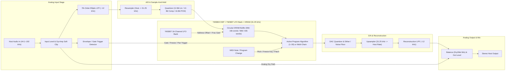

# Digital Symphony Instruments — Aero FX90
## Technical Specification & 30-Preset Parameter Bible

> [!IMPORTANT]
> **Plugin Identity & Target Configuration**
> - **Manufacturer:** Digital Symphony Instruments (`DSI` / `DSym`)
> - **Plugin Name:** Aero FX90 (`AF90`)
> - **Formats:** VST3, Standalone (Cross-platform CMake for Windows x64 & macOS Universal)
> - **Core Engine:** Fixed 31.25 kHz internal DSP clock with modeled 12 kHz steep reconstruction/anti-aliasing filters, 3-way Bit Mode (`12-bit Linear`, `12-bit Companded`, `16-bit Linear PCM`), analog I/O saturation, adjustable noise floor, and `MkI (500 ms)` / `MkII (2000 ms)` DRAM toggle.

---

## 1. Local Build Environment Verification

Your Windows development environment has been inspected and contains all required native compilation tools:

| Tool | Status | Path / Version |
| :--- | :--- | :--- |
| **Visual Studio** | Ready | `C:\Program Files\Microsoft Visual Studio\18\Community` |
| **MSVC C++ Compiler (`cl.exe`)** | Ready | `MSVC 14.51.36231 (Hostx64/x64)` |
| **CMake** | Ready | `Visual Studio\18\Community\...\CMake\bin\cmake.exe` |
| **Git** | Ready | `C:\Program Files\Git\cmd\git.exe` |
| **Project Workspace** | Planned | `C:\Users\serve\.gemini\antigravity\scratch\aero-fx90` |

---

## 2. Hardware & DSP Signal Flow Architecture

The real Yamaha SPX90 (1985) pairs the **YM3804** DSP (64 instructions per sample period of $32\ \mu\text{s}$ at $31.25\text{ kHz}$) with the **YM3807** Modulation Generator (~16 independent LFOs generating address offsets and interpolation gain coefficients) and an external DRAM delay/reverb ring buffer.

### Converter & Character Controls (Ear-Tuning Suite)
1. **Bit Mode Selector:**
   - `16-Bit Linear PCM`: Models the Sony CX20018 / Burr-Brown PCM53JP 16-bit DAC path with 16-bit fixed-point accumulator truncation.
   - `12-Bit Linear`: Truncates internal delay-line storage and converter steps to 4096 discrete levels for maximum early-80s grit on reverb tails and pitch shifts.
   - `12-Bit Companded`: Non-linear chord/step floating quantization (high resolution at quiet levels, coarse quantization on loud transients).
2. **Converter Drive & Headroom:** Models input op-amp saturation and hard two's-complement rail clipping ( triggers the front-panel `OVERFLOW` / peak LED at $-3\text{ dBFS}$).
3. **Anti-Aliasing / Reconstruction Filter:** Steep elliptic/Chebyshev low-pass filter at $12.0\text{ kHz}$ with subtle passband ripple and phase shift characteristic of 1985 active analog filters.
4. **Clock Rate Trim (Modern View):** Defaults to $31.25\text{ kHz}$ ($32\ \mu\text{s}$ sample period), adjustable from $15\text{ kHz}$ to $48\text{ kHz}$, plus an optional `Hi-Fi Bypass` switch.
5. **Memory Model Switch:** `SPX90 MkI` ($500\text{ ms}$ base delay/freeze buffer) vs. `SPX90II MkII` ($2000\text{ ms}$ extended DRAM).

---

## 3. Complete 30 ROM Presets & Parameter Specification Table

On the hardware unit, **Presets 1–30** reside in read-only ROM (attempting to overwrite displays `#1~#30 READ ONLY`), while **Slots 31–90** are writable User RAM memories. Each program exposes up to 9 core parameters (`PARAM 1`–`9`) plus sub-parameters (`UTILITY` / `MIX BALANCE` / `OUT LEVEL`).

### Group A: Reverb & Early Reflections (Presets 1–6)

| # | ROM Name | Algorithm | Default Parameters & Ranges |
| :- | :--- | :--- | :--- |
| **1** | `REV 1 HALL` | **REV (Hall)** | **Rev Time:** `2.6 s` *(0.3–99.0 s)* \| **High:** `0.6` *(0.1–1.0)* \| **Delay:** `30.0 ms` *(0.1–50.0 ms)* \| **HPF:** `THRU` *(THRU, 32 Hz–1.0 kHz)* \| **LPF:** `8.0 kHz` *(1.0–11.0 kHz, THRU)* \| **Balance:** `100%` *(0–100%)* \| **Out Lvl:** `100%` |
| **2** | `REV 2 ROOM` | **REV (Room)** | **Rev Time:** `1.5 s` *(0.3–99.0 s)* \| **High:** `0.7` *(0.1–1.0)* \| **Delay:** `30.0 ms` *(0.1–50.0 ms)* \| **HPF:** `THRU` \| **LPF:** `8.0 kHz` \| **Balance:** `100%` \| **Out Lvl:** `100%` |
| **3** | `REV 3 VOCAL` | **REV (Vocal)** | **Rev Time:** `2.4 s` *(0.3–99.0 s)* \| **High:** `0.5` *(0.1–1.0)* \| **Delay:** `45.0 ms` *(0.1–50.0 ms)* \| **HPF:** `80 Hz` \| **LPF:** `8.0 kHz` \| **Balance:** `100%` \| **Out Lvl:** `100%` |
| **4** | `REV 4 PLATE` | **REV (Plate)** | **Rev Time:** `1.8 s` *(0.3–99.0 s)* \| **High:** `0.7` *(0.1–1.0)* \| **Delay:** `20.0 ms` *(0.1–50.0 ms)* \| **HPF:** `THRU` \| **LPF:** `8.0 kHz` \| **Balance:** `100%` \| **Out Lvl:** `100%` |
| **5** | `EARLY REF 1` | **ER 1** | **Type:** `HALL` *(HALL, RANDOM, REVERSE, PLATE)* \| **Room Size:** `2.0` *(0.1–20.0)* \| **Liveness:** `5` *(0–10)* \| **Delay:** `10.0 ms` *(0.1–400.0 ms)* \| **HPF:** `40 Hz` \| **LPF:** `10.0 kHz` \| **Balance:** `100%` |
| **6** | `EARLY REF 2` | **ER 2** | **Type:** `REVERSE` *(HALL, RANDOM, REVERSE, PLATE)* \| **Room Size:** `2.0` *(0.1–20.0)* \| **Liveness:** `5` *(0–10)* \| **Delay:** `10.0 ms` *(0.1–400.0 ms)* \| **HPF:** `THRU` \| **LPF:** `THRU` \| **Balance:** `100%` |

---

### Group B: Delay, Echo & Modulation (Presets 7–15)

| # | ROM Name | Algorithm | Default Parameters & Ranges |
| :- | :--- | :--- | :--- |
| **7** | `DELAY L,R` | **DELAY** | **Lch Dly:** `100.0 ms` *(0.1–500.0 ms MkI / 2000.0 ms MkII)* \| **Lch F.B.:** `0%` *(-99% to +99%)* \| **Rch Dly:** `200.0 ms` *(0.1–500.0/2000.0 ms)* \| **Rch F.B.:** `0%` *(-99% to +99%)* \| **High:** `1.0` *(0.1–1.0)* \| **Balance:** `50%` |
| **8** | `STEREO ECHO` | **ECHO** | **Lch Dly:** `170.0 ms` *(0.1–250.0 ms MkI / 1000.0 ms MkII)* \| **Lch F.B.:** `50%` *(-99% to +99%)* \| **Rch Dly:** `170.0 ms` \| **Rch F.B.:** `50%` \| **High:** `0.8` *(0.1–1.0)* \| **Balance:** `50%` |
| **9** | `STEREO FLANGE A` | **MOD (Flange A)** | **Mod Frq:** `2.5 Hz` *(0.1–20.0 Hz)* \| **Mod Depth:** `50%` *(0–100%)* \| **Mod Dly:** `1.2 ms` *(0.1–500.0 ms)* \| **F.B. Gain:** `35%` *(-99% to +99%)* \| **Balance:** `50%` |
| **10** | `STEREO FLANGE B` | **MOD (Flange B)** | **Mod Frq:** `0.5 Hz` *(0.1–20.0 Hz)* \| **Mod Depth:** `60%` *(0–100%)* \| **Mod Dly:** `2.0 ms` *(0.1–500.0 ms)* \| **F.B. Gain:** `-50%` *(-99% to +99%)* \| **EQ Low/Mid/Hi** \| **Balance:** `50%` |
| **11** | `CHORUS A` | **MOD (Chorus A)** | **Mod Frq:** `0.2 Hz` *(0.1–20.0 Hz)* \| **DM Depth:** `50%` *(0–100%)* \| **Mod Dly:** `5.0 ms` *(0.1–500.0 ms)* \| **AM Depth:** `40%` *(0–100%)* \| **EQ Low/Mid/Hi** \| **Balance:** `50%` |
| **12** | `CHORUS B` | **MOD (Chorus B)** | **Mod Frq:** `0.6 Hz` *(0.1–20.0 Hz)* \| **DM Depth:** `50%` *(0–100%)* \| **Mod Dly:** `3.5 ms` *(0.1–500.0 ms)* \| **AM Depth:** `40%` *(0–100%)* \| **EQ Low/Mid/Hi** \| **Balance:** `50%` |
| **13** | `STEREO PHASING` | **MOD (Phasing)** | **Mod Frq:** `0.5 Hz` *(0.1–20.0 Hz)* \| **Mod Depth:** `60%` *(0–100%)* \| **Mod Dly:** `1.5 ms` *(0.1–8.0 ms)* \| **F.B. Gain:** `50%` *(0–99%)* \| **Balance:** `50%` |
| **14** | `TREMOLO` | **MOD (Tremolo)** | **Mod Frq:** `5.0 Hz` *(0.1–20.0 Hz)* \| **AM Depth:** `70%` *(0–100%)* \| **DM Depth:** `10%` *(0–100%)* \| **EQ Low/Mid/Hi** \| **Balance:** `100%` |
| **15** | `SYMPHONIC` | **MOD (Symphonic)** | **Mod Frq:** `0.7 Hz` *(0.1–20.0 Hz)* \| **Mod Depth:** `50%` *(0–100%)* \| **EQ Low/Mid/Hi** \| **Balance:** `50%` *(3-voice ultra-short modulated delay chorus with multi-phase YM3807 LFOs & AM)* |

---

### Group C: Gate, Dynamics & Gated Reverbs (Presets 16–20)

| # | ROM Name | Algorithm | Default Parameters & Ranges |
| :- | :--- | :--- | :--- |
| **16** | `GATE REVERB` | **GATE (ER Gate)** | **Type:** `RANDOM` *(HALL, RANDOM, REVERSE, PLATE)* \| **Room Size:** `2.0` *(0.1–20.0)* \| **Liveness:** `5` *(0–10)* \| **Delay:** `10.0 ms` *(0.1–400.0 ms)* \| **HPF:** `THRU` \| **LPF:** `10.0 kHz` \| **Balance:** `100%` |
| **17** | `REVERSE GATE` | **GATE (Rev Gate)** | **Type:** `REVERSE` \| **Room Size:** `2.0` *(0.1–20.0)* \| **Liveness:** `5` *(0–10)* \| **Delay:** `10.0 ms` \| **HPF:** `THRU` \| **LPF:** `10.0 kHz` \| **Balance:** `100%` |
| **18** | `ADR / NOISE GATE` | **GATE (ADR)** | **Trg Lvl:** `50%` *(1–100%)* \| **Trg Dly:** `0.0 ms` *(-100 to +100 ms)* \| **Attack:** `5 ms` *(5–32000 ms)* \| **Hold:** `100 ms` *(5–32000 ms)* \| **Release:** `250 ms` *(5–32000 ms)* \| **MIDI Trg:** `OFF` \| **Balance:** `100%` |
| **19** | `COMPRESSOR` | **GATE (Comp)** | **Trg Lvl (Thresh):** `50%` *(1–100%)* \| **Trg Dly (Lookahead):** `-10.0 ms` *(-100 to +100 ms)* \| **Attack:** `10 ms` \| **Release:** `150 ms` \| **Ratio/Gain:** `Auto` \| **Balance:** `100%` |
| **20** | `REVERB & GATE` | **GATE (Rev+Gate)** | **Rev Time:** `2.0 s` *(0.3–99.0 s)* \| **High:** `0.6` *(0.1–1.0)* \| **Trg Lvl:** `40%` *(1–100%)* \| **Hold:** `120 ms` *(5–32000 ms)* \| **Release:** `90 ms` *(5–32000 ms)* \| **HPF:** `THRU` \| **LPF:** `8.0 kHz` \| **Balance:** `100%` |

---

### Group D: Pitch Change, Freeze, Pan, Vibrato & EQ (Presets 21–30)

| # | ROM Name | Algorithm | Default Parameters & Ranges |
| :- | :--- | :--- | :--- |
| **21** | `PITCH CHANGE A` | **PITCH A (1-Voice + FB)** | **Pitch:** `0` *(-12 to +12 semi)* \| **Fine:** `+10` *(-100 to +100 cents)* \| **Delay:** `0.1 ms` *(0.1–400.0 ms)* \| **F.B. Gain:** `0%` *(-99% to +99%)* \| **Base Key:** `OFF` *(OFF, C1–C6)* \| **Balance:** `50%` |
| **22** | `PITCH CHANGE B` | **PITCH B (2-Voice Mono)** | **1 Pitch:** `0` *(-12 to +12)* \| **1 Fine:** `+8` *(-100 to +100 cents)* \| **1 Dly:** `0.1 ms` *(0.1–400.0 ms)* \| **2 Pitch:** `0` \| **2 Fine:** `-8` \| **2 Dly:** `20.0 ms` \| **Balance:** `50%` |
| **23** | `PITCH CHANGE C` | **PITCH C (2-Voice Stereo)** | **L Pitch:** `0` *(-12 to +12)* \| **L Fine:** `+8` *(classic ±8 / ±10 cent stereo widener)* \| **L Dly:** `0.1 ms` \| **R Pitch:** `0` \| **R Fine:** `-8` \| **R Dly:** `0.1 ms` \| **Balance:** `50%` |
| **24** | `PITCH CHANGE D` | **PITCH D (Stereo MIDI)** | **L Pitch:** `-5` *(-12 to +12)* \| **L Fine:** `0` \| **L Dly:** `0.1 ms` \| **L F.B.:** `0%` \| **R Pitch:** `+7` \| **R Fine:** `0` \| **R Dly:** `0.1 ms` \| **R F.B.:** `0%` \| **Base Key:** `C3` \| **Balance:** `50%` |
| **25** | `FREEZE A` | **FREEZE A (Sampler)** | **Rec Mode:** `AUTO` *(MANUAL, AUTO)* \| **Trg Lvl:** `50%` \| **Trg Dly:** `0.0 ms` *(-500 to +500 ms)* \| **Start:** `0.0 ms` \| **End:** `500.0 ms` *(2000.0 ms MkII)* \| **Trg Mask:** `50 ms` \| **F.B. Gain:** `0%` \| **Balance:** `100%` |
| **26** | `FREEZE B` | **FREEZE B (Pitch Sampler)** | **Rec Mode:** `AUTO` *(MANUAL, AUTO)* \| **Trg Lvl:** `50%` \| **Trg Dly:** `0.0 ms` \| **Pitch:** `0` *(-12 to +12)* \| **Fine:** `0` *(-100 to +100)* \| **Base Key:** `C3` *(MIDI Note Pitch Play)* \| **Balance:** `100%` |
| **27** | `AUTO PAN` | **PAN (LFO Pan)** | **Speed:** `0.7 Hz` *(0.1–20.0 Hz)* \| **Direction:** `L <-> R` *(`L -> R`, `L <- R`, `L <-> R`)* \| **Depth:** `75%` *(0–100%)* \| **EQ Low/Mid/Hi** \| **Balance:** `100%` |
| **28** | `TRIGGERED PAN` | **PAN (Env Pan)** | **Trg Lvl:** `65%` *(1–100%)* \| **Direction:** `L -> R` *(`L -> R`, `L <- R`, `L <-> R`)* \| **Trg Dly:** `-10.0 ms` \| **Attack:** `20 ms` \| **Hold:** `100 ms` \| **Release:** `200 ms` \| **Depth:** `100%` \| **Balance:** `100%` |
| **29** | `DELAY VIBRATO` | **VIBRATO** | **Trg Lvl:** `50%` *(1–100%)* \| **Vib Delay:** `400 ms` *(0–5000 ms onset ramp)* \| **Max Speed:** `6.0 Hz` *(0.1–20.0 Hz)* \| **Max Depth:** `40%` *(0–100%)* \| **Mod Dly:** `2.5 ms` \| **Balance:** `100%` |
| **30** | `PARAMETRIC EQ` | **PEQ (3-Band + Filters)** | **HPF:** `THRU` *(32 Hz–1.0 kHz)* \| **Low Frq/Gain:** `100 Hz / 0 dB` *(±15 dB)* \| **Mid Frq/Gain/Q:** `500 Hz / 0 dB / Q 1.0` *(315 Hz–4.0 kHz, Q 0.5–5.0)* \| **Hi Frq/Gain:** `4.0 kHz / 0 dB` *(800 Hz–11.0 kHz)* \| **LPF:** `THRU` |

---

## 4. Dual-Mode GUI Specification

### Mode 1: Authentic 1985 Hardware Panel (Default Main View)
- **Chassis:** Black anodized 1U 19-inch rackmount faceplate with rack ears, white/gold silkscreen legends, and gold/teal `DIGITAL SYMPHONY INSTRUMENTS — AERO FX90` branding badge.
- **Left Section (Input & Metering):**
  - Rotary **INPUT LEVEL** knob with scale markings (`0` to `10`).
  - **7-Segment Vertical Peak LED Meter** (`-30`, `-20`, `-12`, `-6`, `-3`, `0`, `OVER` in green/amber/red).
  - **INPUT MODE** switch (`MONO` / `STEREO`).
- **Center Display Bezel:**
  - **2-Digit Red 7-Segment LED** displaying memory number (`01`–`90`), with status dots for `MODIFIED` and `MIDI`.
  - **16×2 Yellow-Green Backlit Dot-Matrix LCD** showing Program Name, Parameter Name, and Value cleanly rendered at high DPI.
- **Right Tactile Button Bank:**
  - `BYPASS` (with red LED indicator), `MEMORY`, `RECALL`, `STORE`.
  - `BALANCE`, `OUT LEVEL`, `PARAM`, `UTILITY`, `MIDI` / `TRIGGER`.
  - Increment/Decrement rocker pads (`▲` / `▼`) for Memory and Cursor/Value.

### Mode 2: Modern Studio View (Expandable Drawer / Toggle View)
- **Hands-on Macro & Parameter Knobs:** Large, labeled rotary controls for all active parameters of the current program (no button-paging required), with real-time value readouts.
- **Converter & Hardware Character Strip:**
  - **Bit Mode Switch:** `12-Bit Linear` | `12-Bit Companded` | `16-Bit PCM`
  - **RAM Model Switch:** `SPX90 (1985)` | `SPX90II (2x RAM)`
  - **Converter Drive**, **Noise Floor Trim**, **Clock Rate** ($31.25\text{ kHz}$ default, continuous $15\text{–}48\text{ kHz}$), and **Hi-Fi Filter Bypass**.
- **Multi-Chain Matrix (Modern Mode Exclusive):**
  - Allows chaining **Modulation (Symphonic/Chorus/Flange)** + **Pitch Change** + **Delay/Echo** + **Reverb/Gate** simultaneously in series or parallel.

---

## 5. Implementation Roadmap (Per Brief)

1. **Step 1 (Complete):** Extract all 30 ROM presets, parameter specs, and verify local MSVC/CMake build tools.
2. **Step 2:** Scaffold the cross-platform JUCE CMake project (`Aero FX90`), build the **31.25 kHz Converter & Resampling Engine** (12 kHz elliptic filters, 3-way bit quantizer, noise floor, converter saturation), and build the **Dual-Mode GUI** (Authentic 1U Rack Panel + Modern View drawer).
3. **Step 3:** Build the **YM3807 16-LFO Bank** and **YM3804 Modulated Delay Line** engine; implement `SYMPHONIC` (#15), `CHORUS A/B` (#11–12), `STEREO FLANGE A/B` (#9–10), `STEREO PHASING` (#13), `TREMOLO` (#14), `DELAY VIBRATO` (#29), `DELAY L,R` (#7), and `STEREO ECHO` (#8).
4. **Step 4:** Add `PARAMETRIC EQ` (#30), `AUTO PAN` (#27), `TRIGGERED PAN` (#28), `ADR / NOISE GATE` (#18), `COMPRESSOR` (#19), and `FREEZE A/B` (#25–26).
5. **Step 5:** Add `REV 1–4` (#1–4), `EARLY REF 1–2` (#5–6), `GATE REVERB` (#16), `REVERSE GATE` (#17), and `REVERB & GATE` (#20).
6. **Step 6:** Add `PITCH CHANGE A–D` (#21–24) with authentic dual-pointer de-glitched splicing, latency, splice artifacts, Pitch B mono / Pitch C stereo $\pm 8\text{ cent}$ detuning, and MIDI note tracking.
7. **Step 7:** Compile VST3 & Standalone binaries, run automated DSP verification tests, and package for Chris's ear-tuning sessions.
