# AeroVerb SFX90 (`SFX90`) — Full Technical Specification & Claude Code Audit Brief

**Product Name:** `SFX90` (Front-Panel Model: **AeroVerb SFX90**)  
**Manufacturer:** **Digital Symphony Instruments** (`BUNDLE_ID: com.digitalsymphonyinstruments.sfx90`, `PLUGIN_CODE: SX90`, `MANUFACTURER_CODE: DSIn`)  
**Hardware Reference:** 1985 **Yamaha SPX90 / 1986 SPX90II Professional Digital Multi-Effects Processor**  
**Framework & Language:** C++20 / JUCE 8 (`VST3` & `Standalone` on Windows x64; cross-platform CMake ready for macOS `VST3`/`AU`)  
**Active Project Workspace:** `D:\Pictures\VST-Web Instrument  Builds\SPX-90 Emulation`

---

## 1. Main Purpose, Vision & What We Are Trying to Achieve

### 1.1 The Core Goal
The purpose of **AeroVerb SFX90 (`SFX90`)** is to deliver an uncompromising, **character-first hardware emulation** of the legendary 1985 **Yamaha SPX90** and **SPX90II** 1U rack-mount digital multi-effects processor.

Modern clean algorithmic plugins fail to capture the SPX90 sound because the SPX90’s iconic character comes directly from its **1985 digital hardware constraints**:
1. **31.25 kHz Master Sample Clock** with sharp ~`14 kHz` analog anti-aliasing and reconstruction filters (giving a warm, rolled-off top end that sits naturally in a mix without harsh digital sibilance).
2. **16-Bit / 12-Bit Fixed-Point Quantization & Companding**, `Q1.23` internal DSP accumulator saturation, and `Q1.15` DRAM word truncation (creating grainy, musical reverb tails and crunchy gated decays).
3. **`YM3804` Custom LSI DSP + `YM3807` 16-Channel LFO Address Generator** operating on `64 Kbit` (`500 ms` MkI) or `256 Kbit` (`2000 ms` MkII) DRAM delay buffers, producing the unmistakable 3-voice 120°-offset **Symphonic** chorus (`Preset #14`), splice-windowed **Pitch Change C** stereo detune (`Preset #21`), and metallic, dense **Early Reflections / Gate Reverb** (`Presets #7–#10`).
4. **Analog Dry Signal Path** summed with the 31.25 kHz digitized Wet path via a digitally controlled VCA (`BALANCE`), preserving 100% of the dry transient punch while blending in the 1985 digital wet signal.

### 1.2 Dual-Ergonomics Philosophy
- **Collapsed 1U Hardware Rack View (`1760 × 192 px`, ~`9.17 : 1` aspect ratio):** Looks, feels, and operates like a physical 1U rack unit mounted in a studio rack, complete with the recessed smoked-acrylic display window, 7-bar LED peak meter, slanted 2-digit red 7-segment `MEMORY` display (which flashes when browsing presets until `RECALL` is pressed), true `16×2` `5×7` dot-matrix backlit olive-green LCD with 8th cursor underline row, staggered cross-cluster tactile buttons, `1/4"` chrome trigger/bypass jacks, and the engraved **Digital Symphony Instruments** manufacturer lockup.
- **Expandable Studio View Drawer (`1760 × 582 px`):** Toggled exclusively via the **`STUDIO VIEW ▼ / ▲`** button (with manual corner window resizing disabled so the user cannot accidentally reveal empty canvas). Slides down a smoked-acrylic studio console exposing 8 context-sensitive rotary knobs (`Param 1`–`8`), `Mix Balance`, `Output Level`, a **Converter & Clock Character Lab** (`12-Bit Linear` / `12-Bit Companded` / `16-Bit Linear PCM`, `SPX90 MkI 500 ms` vs `SPX90II MkII 2000 ms` DRAM, variable `15.625 kHz – 48 kHz` DSP clock, `ADC Drive`, `Noise Floor`, `Hi-Fi Filter Bypass`), and a **Modern Multi-Chain Routing Matrix** (`MOD -> PITCH -> DELAY -> REVERB`).

---

## 2. Project File Structure & Architecture Map

All files reside in `D:\Pictures\VST-Web Instrument  Builds\SPX-90 Emulation`:

```text
D:\Pictures\VST-Web Instrument  Builds\SPX-90 Emulation\
├── CMakeLists.txt                          # CMake build config (Targets: AeroFX90_VST3, AeroFX90_Standalone, AeroFX90_Tests)
├── Build_and_Install_SFX90.bat             # One-click MSVC build & VST3 installer script
├── README.md                               # Build & usage documentation
├── Source/
│   ├── PluginProcessor.h                   # JUCE AudioProcessor, APVTS parameter tree, panel state machine
│   ├── PluginProcessor.cpp                 # Bidirectional APVTS <-> Program sync, MIDI Program Change, XML state I/O
│   ├── PluginEditor.h                      # JUCE AudioProcessorEditor, custom HardwareLookAndFeel, layout state
│   ├── PluginEditor.cpp                    # 1U faceplate rendering, 5x7 dot-matrix LCD, 7-seg LED, .mfr logo, Studio View
│   ├── UI/
│   │   ├── JuraFontData.h                  # Embedded Google Fonts 'Jura' Regular (400) & SemiBold (600) TTF byte arrays
│   │   ├── Jura-Regular.ttf                # Source TTF (weight 400)
│   │   └── Jura-SemiBold.ttf               # Source TTF (weight 600)
│   ├── DSP/
│   │   ├── FixedPointUtils.h               # Q1.23 & Q1.15 fixed-point truncation, 12-bit linear/companded ADC/DAC, TPDF dither
│   │   ├── ConverterEngine.h               # Pre-ADC & Post-DAC 4th-order Butterworth filters (cached), 31.25 kHz resampler
│   │   ├── Ym3807LfoBank.h                 # Emulated Yamaha YM3807 16-channel phase-offset hardware LFO bank (12-bit quantized)
│   │   ├── DelayMemoryBuffer.h             # Circular DRAM buffer with Q1.15 storage, linear & 4-pt Hermite fractional reads
│   │   ├── ReverbAlgorithms.h              # REV 1–4, ER 1–2, Delay & ER 1–2, Gate Reverb, Reverb & Gate (cached comb/ER gains)
│   │   ├── ModulationAlgorithms.h          # Symphonic (3-voice 120°), Flanger A/B, Chorus A/B, Phaser (8/12-stage), Tremolo, Auto Pan
│   │   ├── PitchDelayGateAlgorithms.h      # Pitch A/B/C/D (dual Hann-windowed splice grains), Delay L/R, Echo, Vibrato, Freeze A/B, ADR, Comp, Exciter, Pan, Delay+Chorus, 3-Band Parametric EQ
│   │   ├── Spx90DspEngine.h                # Master DSP engine orchestrating converter, single/multi-chain routing, VCA ducking
│   │   └── Spx90DspEngine.cpp              # Per-sample processing loop, 1-pole parameter smoothing, click-free preset switching
│   └── Presets/
│       ├── Spx90ProgramTypes.h             # AlgorithmType enum (28 types), RamModel (MkI/MkII), BitDepthMode, ProgramData struct
│       └── Spx90PresetDatabase.h           # All 30 authentic SPX90 Factory ROM presets (#1–#30) + 60 initialized User RAM slots (#31–#90) + parameter metadata & LCD string formatters
└── Tests/
    └── DspVerificationMain.cpp             # Standalone automated test suite (32/32 DSP, preset, and state persistence assertions)
├── Docs/
│   ├── aero_fx90_rack_closed.png           # Rendered 1U Rack View snapshot (1760x192 @ 1.5x DPI)
│   ├── aero_fx90_studio_open.png           # Rendered Expanded Studio View snapshot (1760x582 @ 1.5x DPI)
│   ├── aero_fx90_display_closeup.png       # Rendered Central Display Window close-up (5x7 LCD + 7-seg + LED meter)
│   └── sfx90_dsi_logo_closeup.png          # Rendered Right-Hand Faceplate close-up (.mfr Digital Symphony Instruments logo)
```

---

## 3. Detailed DSP Architecture & Signal Flow

```mermaid
flowchart LR
    In["Stereo Input (Host SR)"] --> Drive["Analog Input Stage (+6 dB Drive & Soft Clip)"]
    Drive --> DryPath["Analog Dry Path (Zero-Latency)"]
    Drive --> PreAA["Pre-ADC 14 kHz 4th-Order Butterworth LPF + 18 Hz DC Blocker"]
    PreAA --> Down["Downsampler (Host SR -> 31.25 kHz Clock)"]
    Down --> QuantIn["ADC Quantizer (16-Bit PCM / 12-Bit Companded / 12-Bit Linear + Dither)"]
    QuantIn --> CoreDSP["YM3804 Core DSP + YM3807 16-Ch LFO + Q1.15 DRAM (Single Algorithm or Multi-Chain)"]
    CoreDSP -->RecallVCA["Preset-Switch Click-Free VCA Envelope (~10 ms Duck/Clear/Fade)"]
    RecallVCA --> QuantOut["DAC Output Stage & Analog Noise Floor"]
    QuantOut --> Up["Zero-Order Hold / Hermite Upsampler (31.25 kHz -> Host SR)"]
    Up --> PostRec["Post-DAC 14.2 kHz 4th-Order LPF + 11.5 kHz Presence Shelf"]
    DryPath -->VCAMix["Digitally Controlled Analog VCA Balance (Dry / Wet) + Output Level"]
    PostRec --> VCAMix
    VCAMix --> Out["Stereo Output"]
```



### 3.1 Converter & Clock Engine (`Source/DSP/ConverterEngine.h` & `FixedPointUtils.h`)
1. **Input Trim & Saturation:**
   - Input gain (`-24 dB` to `+12 dB`) + Converter Drive (`0 dB` to `+18 dB`) feeding `FixedPoint::analogInputClip()` (clean up to `0.85`, smooth cubic saturation knee above `0.85`, hard ceiling `±1.25`).
2. **Pre-ADC Anti-Aliasing Filter:**
   - `18 Hz` high-pass DC-blocking biquad followed by two cascaded 2nd-order Butterworth low-pass sections at `14.0 kHz` (`Q = 0.5412` and `Q = 1.3065`), modeling the sharp analog anti-aliasing filter ahead of the 31.25 kHz sample-and-hold circuit.
   - **Optimization Implemented:** `BiquadFilter` caches `(type, cutoffHz, q, gainDb, sampleRate)` via `checkAndUpdateCache()` so `std::sin`, `std::cos`, and `std::pow` are only recomputed when parameters or sample rate actually change.
3. **31.25 kHz Variable Clock Downsampler / Upsampler:**
   - Supports nominal `31,250 Hz` clock as well as real-time under/over-clocking from `15,625 Hz` to `48,000 Hz`.
   - Accumulates fractional clock phase `ratio = targetClockHz / hostSampleRate`. Whenever the internal 31.25 kHz clock ticks, it quantizes the sample via `FixedPoint::quantizeConverterSample()` (`16-Bit Linear`, `12-Bit Companded`, or `12-Bit Linear` with TPDF dither) and executes one tick of the inner `YM3804` DSP callback.
   - Reconstructs back to the host sample rate using a blend of 4-point Hermite cubic interpolation (`70%`) and zero-order sample-and-hold staircasing (`30%`), followed by the post-DAC `14.2 kHz` 4th-order Butterworth reconstruction filter and a `+0.6 dB` shelf at `11.5 kHz`.

### 3.2 `YM3807` 16-Channel LFO Bank (`Source/DSP/Ym3807LfoBank.h`)
- Models the hardware `YM3807` LFO chip with 16 concurrent channels, configurable initial phase offsets (e.g., `0°`, `120°`, `240°` for `SYMPHONIC`), and 12-bit quantized output (`round(v * 2048.0f) / 2048.0f`).
- Supports `Triangle`, `Sine`, `Sawtooth`, `SampleAndHold` (32-bit LCG PRNG updated on phase wrap), and `Envelope` waveforms.

### 3.3 All 28 Algorithm Implementations across 30 Factory Presets
| Factory Slot(s) | Algorithm Name | Implementation File & Key DSP Details |
| :--- | :--- | :--- |
| **#1–#4** | `REV 1 HALL`, `REV 2 ROOM`, `REV 3 VOCAL`, `REV 4 PLATE` | [`ReverbAlgorithms.h`](file:///D:/Pictures/VST-Web%20Instrument%20%20Builds/SPX-90%20Emulation/Source/DSP/ReverbAlgorithms.h): Pre-delay -> Input HPF/LPF -> 2-stage short input all-pass diffuser -> 24-tap Early Reflections (`Hall`/`Random`/`Reverse`/`Plate` tap tables) -> 6 parallel modulated low-pass-damped comb filters with 90%/10% stereo cross-coupling & `Q1.23` saturation -> 2-stage output series all-pass diffuser. Comb decay gains and ER tap weights are cached (`cachedCombGainL_/R_`, `cachedErGainL_/R_`). |
| **#5–#6** | `EARLY REF 1`, `EARLY REF 2` | [`ReverbAlgorithms.h`](file:///D:/Pictures/VST-Web%20Instrument%20%20Builds/SPX-90%20Emulation/Source/DSP/ReverbAlgorithms.h): Pure 24-tap stereo early-reflection clusters (`RoomSize 0.1–20.0` scales tap spacing; `Liveness 0–10` controls feedback + high-frequency damping). |
| **#7–#8** | `DELAY & ER 1`, `DELAY & ER 2` | [`ReverbAlgorithms.h`](file:///D:/Pictures/VST-Web%20Instrument%20%20Builds/SPX-90%20Emulation/Source/DSP/ReverbAlgorithms.h): Independent L/R regenerative delay lines combined with the 24-tap early reflection cluster. |
| **#9** | `GATE REVERB` | [`ReverbAlgorithms.h`](file:///D:/Pictures/VST-Web%20Instrument%20%20Builds/SPX-90%20Emulation/Source/DSP/ReverbAlgorithms.h): Dense non-exponential gated early-reflection cluster (`Reverse` / `Plate` / `Random` envelopes) for the classic 1980s snare gate. |
| **#10** | `REVERB & GATE` | [`ReverbAlgorithms.h`](file:///D:/Pictures/VST-Web%20Instrument%20%20Builds/SPX-90%20Emulation/Source/DSP/ReverbAlgorithms.h): Full `REV` tank followed by a sidechain input-triggered noise gate with `Threshold (-60..0 dB)`, `Hold (1..2000 ms)`, and `Decay/Release`. |
| **#11–#13** | `DELAY L,R`, `STEREO ECHO`, `DELAY VIBRATO` | [`PitchDelayGateAlgorithms.h`](file:///D:/Pictures/VST-Web%20Instrument%20%20Builds/SPX-90%20Emulation/Source/DSP/PitchDelayGateAlgorithms.h): Dual DRAM delay lines (`500 ms` MkI / `2000 ms` MkII ceiling) with high-frequency feedback damping (`HIGH 0.1–1.0`), cross-coupled stereo echo feedback, and `YM3807` LFO read-pointer modulation (`DELAY VIBRATO`). |
| **#14** | `SYMPHONIC` | [`ModulationAlgorithms.h`](file:///D:/Pictures/VST-Web%20Instrument%20%20Builds/SPX-90%20Emulation/Source/DSP/ModulationAlgorithms.h): Signature SPX90 3-voice (`0°`, `120°`, `240°`) stereo multi-tap modulated delay network with `6 kHz` warmth low-pass filter. |
| **#15–#18** | `FLANGER A/B`, `CHORUS A/B`, `PHASER`, `TREMOLO`, `AUTO PAN` | [`ModulationAlgorithms.h`](file:///D:/Pictures/VST-Web%20Instrument%20%20Builds/SPX-90%20Emulation/Source/DSP/ModulationAlgorithms.h): Fractional Hermite delay flanger/chorus with `Q1.23` regeneration; 8/12-stage cascaded first-order all-pass phaser; LFO amplitude/panning modulators. |
| **#19–#22** | `PITCH CHANGE A, B, C, D` | [`PitchDelayGateAlgorithms.h`](file:///D:/Pictures/VST-Web%20Instrument%20%20Builds/SPX-90%20Emulation/Source/DSP/PitchDelayGateAlgorithms.h): Dual `180°`-offset Hann-windowed circular splice grain pointers (`28 ms` splice window at `31.25 kHz`). `Pitch C` provides true stereo dual-voice detuning (`±1200 cents` coarse + `±100 cents` fine). |
| **#23–#24** | `FREEZE A`, `FREEZE B` | [`PitchDelayGateAlgorithms.h`](file:///D:/Pictures/VST-Web%20Instrument%20%20Builds/SPX-90%20Emulation/Source/DSP/PitchDelayGateAlgorithms.h): DRAM sample-and-hold audio recorder triggered by input threshold or manual/MIDI trigger, with adjustable `Start`/`End` points, loop/one-shot mode, and variable-pitch playback (`Freeze B`). |
| **#25–#30** | `ADR / NOISE GATE`, `COMPRESSOR`, `HARMONIC EXCITER`, `PAN`, `DELAY & CHORUS`, `PARAMETRIC EQ` | [`PitchDelayGateAlgorithms.h`](file:///D:/Pictures/VST-Web%20Instrument%20%20Builds/SPX-90%20Emulation/Source/DSP/PitchDelayGateAlgorithms.h): Envelope-triggered ADR/Gate, VCA Compressor, high-passed odd/even harmonic generator (`Exciter`), auto/manual panner, parallel/series Delay+Chorus, and 3-band Parametric EQ. |

### 3.4 Click-Free Preset Switching & Parameter Smoothing (`Source/DSP/Spx90DspEngine.cpp`)
- **Live Preset/Algorithm Recall Ducking:** When the user recalls a new preset or changes algorithms while audio is playing, `Spx90DspEngine::setActiveProgram()` stages the new program in `pendingProgram_` and ramps `recallWetEnv_` down to `0.0` over `~5 ms`, clears the delay/reverb tanks (`reverbDsp_.reset()`, `modDsp_.reset()`, `pitchDelayDsp_.reset()`) at the zero crossing, swaps in the new algorithm, and ramps `recallWetEnv_` back to `1.0` over `~5 ms`.
- **Per-Sample 1-Pole Smoothing:** `Input Level`, `Mix Balance`, and `Output Level` use per-sample 1-pole smoothing inside `processBlock` to eliminate zipper noise during automation or knob turns.

---

## 4. Front-Panel UI, Manufacturer Logo & Host Integration (`Source/PluginEditor.cpp` & `PluginProcessor.cpp`)

### 4.1 Ultra-Sleek 1U Faceplate & Locked Window Sizing
- **Dimensions:** `1760 × 192 px` (collapsed 1U rack) and `1760 × 582 px` (expanded Studio View).
- **No Corner Resize Handle:** `setResizable(false, false)` is enforced so dragging a window corner cannot expose empty background space. The window size only changes via the smooth `60 Hz` animated **`STUDIO VIEW ▼ / ▲`** button.
- **Authentic SPX90 Front-Panel Controls:**
  - `POWER` switch, `INPUT` rotary level pot, 7-bar LED input ladder (`0`, `-3`, `-6`, `-10`, `-15`, `-20`, `-30 dB`), slanted 2-digit red 7-segment `MEMORY` readout (flashes when previewing a slot with `MEMORY ▲/▼` until `RECALL` is pressed), and a true `16×2` character `5×7` pixel dot-matrix backlit LCD with an 8th cursor underline row.
  - Staggered cross button banks (`PARAMETER`, `VALUE ▲/▼`, `BALANCE`, `STORE`, `MEMORY ▲/▼`, `RECALL`, `UTILITY`, `FOOT TRIGGER`, `BYPASS`) and `1/4"` chrome jacks (`MEMORY TRIGGER`, `BYPASS`).

### 4.2 Exact `.mfr` Manufacturer Logo Lockup (`drawManufacturerBadge()`)
- Rendered directly on the right-hand anodized faceplate space (`x = 1526, y = 74, w = 180, h = 32`) above the **`STUDIO VIEW ▼`** button (`x = 1551, y = 162, w = 130, h = 22`).
- Uses embedded Google Fonts **Jura Regular (`400`)** and **Jura SemiBold (`600`)** from [`Source/UI/JuraFontData.h`](file:///D:/Pictures/VST-Web%20Instrument%20%20Builds/SPX-90%20Emulation/Source/UI/JuraFontData.h).
- Matches the exact HTML/SVG/CSS specification:
  - Color `#d6d0c2` for all elements with engraved filter (`drop-shadow(0 1px 0 rgba(255,255,255,.16))` and `drop-shadow(0 -1px 0 rgba(0,0,0,.7))`).
  - `32×32 px` piano-keys SVG mark (`viewBox="0 0 64 64"`, `opacity: 0.5`).
  - `1×28 px` vertical rule (`opacity: 0.35`) with `11 px` horizontal gaps.
  - Line 1: `"DIGITAL SYMPHONY"` in `600 10.5px 'Jura'` (`letter-spacing: 0.2em`, `margin-right: -0.2em`).
  - Line 2: `"INSTRUMENTS"` in `400 8.5px 'Jura'` (`opacity: 0.85`), with all 11 individual letter spans distributed via `space-between` so `I` starts at the exact left ink edge of `D` and `S` ends at the exact right ink edge of `Y`.

### 4.3 DAW Automation & State Persistence (`Source/PluginProcessor.cpp`)
- Exposes all 8 active program parameters (`param1`–`param8`) plus global parameters (`inputLevel`, `balance`, `outLevel`, `bypass`, `clockRate`, `bitMode`, `ramModel`, `converterDrive`, `noiseFloor`, `hiFiBypass`, `multiChain`, `chainMod`, `chainPitch`, `chainDelay`, `chainReverb`) in `juce::AudioProcessorValueTreeState` (`apvts`).
- Bidirectional synchronization (`pushWorkingParamsToApvts()` and `syncDspFromState()`) ensures DAW automation curves, hardware front-panel `VALUE ▲/▼` edits, and Studio View knobs stay in lockstep.
- Full XML state save/restore serializes all 90 preset slots (including user-stored custom names and parameters in RAM `#31–#90`), active slot index, and APVTS parameters.

---

## 5. Automated Verification Suite (`Tests/DspVerificationMain.cpp`)

The standalone test executable (`build\AeroFX90_Tests_artefacts\Release\AeroFX90_Tests.exe`) runs **32 automated assertions** covering:
1. `REV 1 HALL` stereo tail generation, bounded output, and RT60 decay progression.
2. `SYMPHONIC` (#14) stereo decorrelation (`L != R`) via the 3-phase `YM3807` LFO network.
3. `PITCH CHANGE C` (#21) stereo detune vs `PITCH CHANGE B` (#20) mono pitch shift.
4. `SPX90 MkI (500 ms)` vs `SPX90II MkII (2000 ms)` DRAM delay ceiling enforcement.
5. `12-Bit Companded` vs `16-Bit Linear PCM` quantization step differences.
6. Exhaustive stress test of **all 30 Factory ROM presets (`#1–#30`)** + **Multi-Chain mode** for NaN/Inf/denormal safety and bounded peak levels (`< 4.0`).

---

## 6. Audit Checklist for Claude Code

When reviewing this repository (`D:\Pictures\VST-Web Instrument  Builds\SPX-90 Emulation`), please inspect the source files and check for any potential issues or improvements across these areas:

1. **Real-Time Audio Thread Safety (`processBlock` & `Spx90DspEngine`):**
   - Verify there are zero heap allocations (`std::vector` resizing, `std::string` allocations, locks, or blocking calls) on the audio thread during `processBlock()`, `processSingleAlgorithmSample()`, or `setActiveProgram()`.
   - Check if `workingProgram_` / `memoryBank_` access between the message thread (`pressValueUp`, `pressRecall`, `setStateInformation`) and the audio thread (`syncDspFromState`) has any potential data race that should be guarded with a spinlock/atomic or double-buffer.
2. **Sample-Rate & Block-Size Edge Cases:**
   - Check behavior across host sample rates (`44.1 kHz`, `48 kHz`, `88.2 kHz`, `96 kHz`, `192 kHz`)—specifically in `ConverterEngine::processSample()` when `hostSampleRate_` is much higher than `targetClockHz_` (`31.25 kHz`), or when `targetClockHz_` (`48 kHz` overclocked) exceeds `hostSampleRate_` (`44.1 kHz`).
3. **DSP Algorithm Authenticity & Stability:**
   - Check feedback loops in `ReverbAlgorithms.h`, `ModulationAlgorithms.h` (`Flanger`, `Phaser`), and `PitchDelayGateAlgorithms.h` (`Delay L,R`, `Stereo Echo`, `Pitch Change A–D`, `Compressor`, `Parametric EQ`) for unconditional stability at extreme parameter settings (`Feedback = 99%`, `Liveness = 10`, `Rev Time = 99.0 s`).
   - Verify `ScopedNoDenormals` coverage and check if any state variables in `BiquadFilter` or comb/all-pass buffers could accumulate denormals during long silence.
4. **APVTS Bidirectional Sync (`PluginProcessor.cpp`):**
   - Check `syncDspFromState()` and `pushWorkingParamsToApvts()` to ensure host automation playback of `param1`–`param8` does not fight with preset recall (`recallProgram()` / `pressRecall()`) or cause unnecessary `setActiveProgram()` ducking triggers when only a continuous parameter value changes.
5. **UI & Graphics Rendering (`PluginEditor.cpp`):**
   - Verify the `60 Hz` `timerCallback()` only triggers `repaint()` when needed or whether static background layers (such as the brushed anodized faceplate or dot-matrix unlit grid) could benefit from caching if CPU usage on high-DPI displays is high.
   - Verify that `.mfr` manufacturer logo rendering in `drawManufacturerBadge()` matches the exact CSS/SVG specification under all DPI scale factors.
